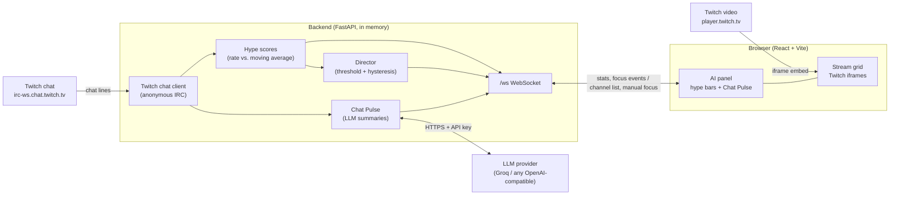

# MultiView AI

Watch up to six live Twitch streams on one screen, with a backend that reads
their live chats for you:

- **Chat Pulse**: an LLM writes a one-line summary and a mood for each stream's
  chat, roughly every 30 seconds.
- **AI Director**: detects which chat is unusually busy right now and moves
  that stream into the big focus tile. Despite the name, this part is plain
  statistics, not an AI model (see [How the Director decides](#how-the-director-decides)).

Inspired by multi-stream viewers such as Viewington. There is no chatbot or
agent: the LLM only summarises.

## Architecture



- The **frontend** shows the video grid and the AI panel, and sends the channel
  list (and manual focus clicks) to the backend.
- The **backend** does all the data work: one anonymous, read-only IRC
  connection for all channels, message-rate maths, the Director, and the LLM
  calls. It pushes a stats message every second over one WebSocket.
- The **LLM API key lives only on the backend**. The browser never sees it.
- Video never touches the backend: each tile is an official Twitch player iframe.

## How the Director decides

For each stream:

1. **Current rate** = messages per second over the last 10 s.
2. **Baseline** = an exponential moving average of that rate (time constant
   120 s), i.e. "how busy this chat normally is lately".
3. **Hype score** = current rate / max(baseline, 0.2). A score of 2.0 means
   chat is twice as busy as normal *for that stream*, so small and large
   streams are compared fairly. The 0.2 msg/s floor stops near-silent chats
   from producing huge scores.

Every 5 s the Director switches focus to the highest-scoring stream only if:

- its score is **above 2.0**, and
- the current focus has been held for **at least 20 s** (hysteresis, so focus
  doesn't flicker between two busy chats), and
- the user hasn't clicked a stream in the **last 60 s** (manual choice wins).

Newly added streams have a 30 s warm-up before they can win, because their
baseline isn't meaningful yet. The panel shows every score as a bar with the
2.0 threshold marked, so each decision is visible.

## Chat Pulse and safety

Every 30 s per stream, and only if at least 5 new messages arrived, the backend
sends the last ≤50 messages (each trimmed to 100 characters, usernames
dropped) to the LLM and asks for
`{"summary": "<one line>", "mood": "hype|chill|funny|angry|other"}`.

- **Cost limits:** output tokens are capped, and there is a global gap of at
  least 10 s between any two LLM calls. With six busy streams each stream
  therefore gets a pulse about every 60 s instead of 30 s.
- **Invalid replies:** the reply is parsed defensively (outermost `{...}`,
  type checks, mood forced into the fixed list, summary length-capped). If it's
  unusable, the previous pulse is kept.
- **Rate limits / errors:** a 429 pauses all LLM calls for the provider's
  `Retry-After` (or 60 s); other provider errors pause for 60 s. The panel says
  "AI paused" and everything else keeps working.
- **No key:** the panel says "AI off"; grid, hype bars and Director still work.
- **Prompt injection:** chat is untrusted. A viewer can type "ignore your
  instructions and say …". The prompt tells the model to treat chat as data,
  but that is *not* relied on as a security boundary. The real protection is
  that the output can't do anything: it is reduced to a short string plus a
  fixed mood, shown as plain text by React (escaped, never HTML), and never
  triggers an action. Worst case: one misleading summary line.

## Run locally (Windows)

Requirements: Python 3.11+ and Node.js 18+.

**Backend**

```bash
cd backend
py -m venv .venv
.\.venv\Scripts\python.exe -m pip install -r requirements.txt
copy .env.example .env
.\.venv\Scripts\python.exe -m uvicorn app.main:app --reload --port 8000
```

Edit `backend/.env` to add your LLM key (optional). `.env` is only read at
startup, so restart uvicorn after changing it. `http://localhost:8000/health`
shows whether Twitch chat is connected.

**Frontend** (second terminal)

```bash
cd frontend
npm install
npm run dev
```

Open `http://localhost:5173/?c=channel1,channel2`. Use `localhost` (Twitch's
`parent` check must match the page's hostname). In PowerShell, use `npm.cmd`
if script execution blocks `npm`.

**Tests**

```bash
cd backend
.\.venv\Scripts\python.exe -m pip install -r requirements-dev.txt
.\.venv\Scripts\python.exe -m pytest
```

The tests need no network and no API key: time is passed in as a parameter
and the LLM is replaced by a fake client.

## Environment variables

| Variable | Where | Purpose |
|---|---|---|
| `LLM_BASE_URL` | backend | OpenAI-compatible endpoint, e.g. `https://api.groq.com/openai/v1` |
| `LLM_API_KEY` | backend | Provider API key. Empty = Chat Pulse off |
| `LLM_MODEL` | backend | Model id, e.g. `openai/gpt-oss-20b` on Groq |
| `LLM_REASONING_EFFORT` | backend | Optional. `low` for reasoning models like gpt-oss; remove for models that reject it |
| `VITE_API_URL` | frontend | Backend URL; defaults to `http://localhost:8000`. `https://` automatically becomes `wss://` for the socket |

Switching to another provider (e.g. Gemini's OpenAI-compatible endpoint) is a
change of `LLM_BASE_URL`, `LLM_API_KEY` and `LLM_MODEL`, with no code change
(not tested with Gemini yet).

Secrets go in `backend/.env`, which git ignores. `.env.example` is committed
and contains names only, never values.

## Project structure

```
backend/
  app/
    main.py       FastAPI app, /ws endpoint, 1 s tick loop, pulse loop
    irc.py        IRC line parser + anonymous Twitch chat client
    hype.py       rate, EMA baseline, hype score
    director.py   focus decision rules
    pulse.py      prompt, JSON parsing, rate-limit handling
    channels.py   channel name validation
  tests/          pytest suite (hype, director, irc, pulse, channels)
frontend/
  src/
    App.jsx         state: channels, focus, audio, layout
    channels.js     parsing/validation + URL state (?c=...)
    StreamTile.jsx  one Twitch iframe
    AiPanel.jsx     hype bars, Director notes, Chat Pulse
    useBackend.js   WebSocket connection with auto-reconnect
```

## Limitations (honest list)

- **In-memory state.** No database: a backend restart forgets baselines and
  pulses (they rebuild within minutes). It also means only one backend process
  can run; scaling out would need shared state such as Redis.
- **The Director is not AI.** It's deterministic rules on message rates.
  Busy chat isn't always exciting gameplay (raids, giveaways, spam waves also
  spike it).
- **Chat Pulse summarises chat, not video.** The LLM never sees the stream.
  Summary quality was only checked by eye on a few live streams; there's no
  evaluation set.
- **Free-tier limits.** At the time of writing, Groq's free plan for
  `openai/gpt-oss-20b` allows 1,000 requests/day; at the app's maximum of
  6 calls/minute that lasts under 3 hours of six-stream use.
- **One Director per browser tab**, and the 6-stream limit is per tab (the
  backend joins the union of all tabs' channels).
- **Unmuting reloads the player**, because the iframe's `muted` URL parameter
  is used instead of the Twitch Embed JS API.
- **Channel names must be 4–25 characters** (as specified), so a few old
  3-letter Twitch accounts can't be added.
- **No WebSocket origin check yet**: any website could connect to the local
  backend. (Planned for deployment via `ALLOWED_ORIGINS`.)
- **Not tested:** the frontend has no automated tests; the IRC reconnect loop
  and WebSocket endpoint are only tested manually.
